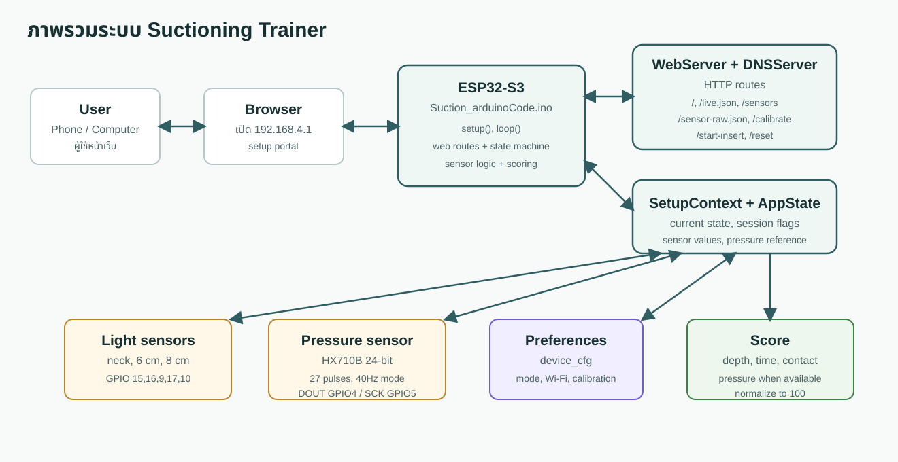
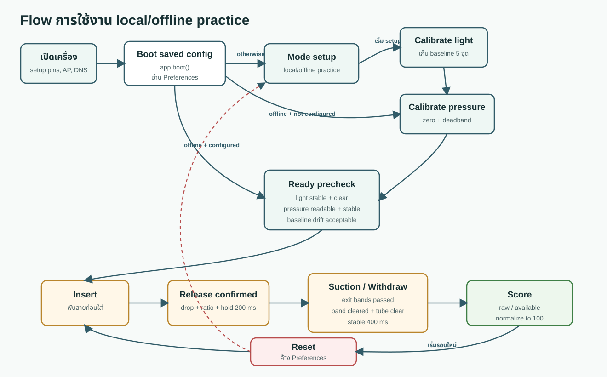
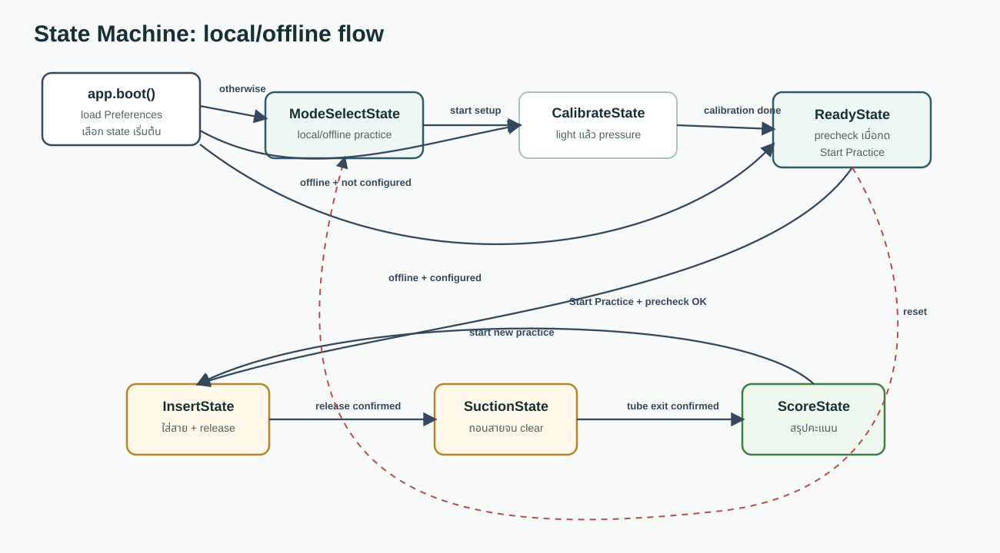
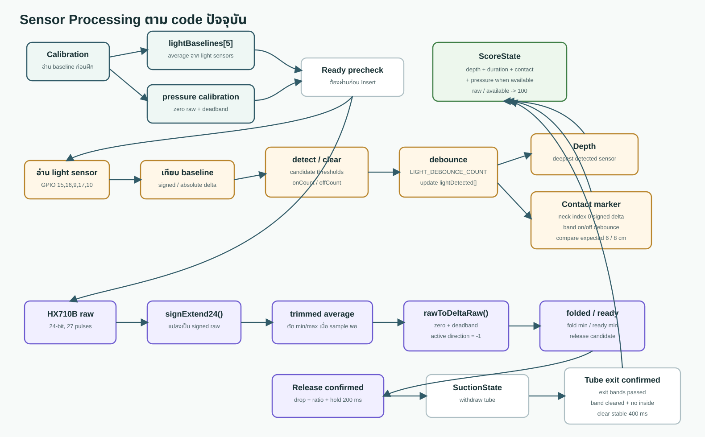

# Suctioning Trainer

โปรเจกต์นี้เป็น firmware สำหรับ ESP32-S3 ที่ใช้ควบคุมเครื่องฝึก suctioning ตัวบอร์ดเปิด Wi-Fi setup portal ให้ผู้ใช้เข้าเว็บจากมือถือหรือคอมพิวเตอร์ จากนั้นหน้าเว็บจะพาไปตามขั้นตอน calibrate sensor, เริ่มฝึก, ตรวจการใส่สาย, ตรวจแรง suction, ตรวจ marker/contact, ถอนสาย และสรุปคะแนน

โค้ดหลักเกือบทั้งหมดอยู่ใน `Suction_arduinoCode.ino` โดยออกแบบเป็น state machine แต่ละ state แทนหนึ่งช่วงของการใช้งานจริง เช่น หน้าเลือกโหมด, หน้า calibration, หน้า insert, หน้า suction และหน้า score

เอกสารและ diagram ชุดนี้อธิบาย flow ที่พร้อมใช้ในปัจจุบันคือ local/offline practice เท่านั้น

## แผนภาพรวมระบบ

## ไฟล์ในโปรเจกต์

| ไฟล์ | หน้าที่ |
| --- | --- |
| `Suction_arduinoCode.ino` | firmware หลักทั้งหมด มี web UI, route, state machine, sensor logic, calibration, scoring, `setup()` และ `loop()` |
| `SensorStats.h` | struct สำหรับเก็บค่าเฉลี่ย, min, max และ range ของ sensor |
| `README.md` | ข้อมูลย่อของโปรเจกต์, pin และ library |
| `docs/HANDOFF.md` | ภาพรวมระบบและคำอธิบายโค้ด |

## จุดเริ่มอ่านโค้ด

อ่าน `Suction_arduinoCode.ino` ตามกลุ่มนี้จะเห็นภาพเร็วที่สุด:

1. ค่าคงที่ด้านบนไฟล์: pin, threshold, sample count, scoring constant
2. `DeviceConfig`: ค่า config ที่บันทึกข้ามการ restart
3. `AppState`: interface ของ state machine
4. `SetupContext`: object กลางที่เก็บสถานะ sensor, session, score และ current state
5. กลุ่ม state classes ของ flow หลัก: `ModeSelectState`, `CalibrateState`, `ReadyState`, `InsertState`, `SuctionState`, `ScoreState`
6. กลุ่ม sensor helpers: `readLightStats()`, `readPressureRawStatsWithTimeout()`, `rawToDeltaRaw()`, `pressureDeltaRawToMmHg()`
7. HTTP handlers และ `setup()` / `loop()` ด้านล่างไฟล์

## Hardware และ Pin

Light sensor มีทั้งหมด 5 จุด:

| ใช้ทำอะไร | index ใน array | GPIO | ความหมาย |
| --- | ---: | ---: | --- |
| จุดเข้าคอ / ตรวจ black marker | 0 | 15 | ใช้เริ่ม tracking และตรวจ marker/contact |
| ระดับ 6 cm | 1 | 16 | ตรวจว่าถึง 6 cm |
| ระดับ 6 cm | 2 | 9 | ตรวจว่าถึง 6 cm |
| ระดับ 8 cm | 3 | 17 | ตรวจว่าถึง 8 cm |
| ระดับ 8 cm | 4 | 10 | ตรวจว่าถึง 8 cm |

Pressure sensor:

| สัญญาณ | GPIO |
| --- | ---: |
| HX710B DOUT | 4 |
| HX710B SCK | 5 |

Wi-Fi setup portal:

- AP SSID: `ESP32-Setup`
- AP password: `12345678`
- Setup IP: `192.168.4.1`

## Flow การใช้งาน

ตอนเปิดเครื่อง `app.boot()` จะดูค่าที่เคยบันทึกไว้ใน `Preferences` ก่อน จึงไม่ได้เริ่มที่ `ModeSelectState` เสมอไป:

- offline + ยังไม่ `configured` -> `CalibrateState`
- offline + `configured` แล้ว -> `ReadyState`
- กรณีอื่น -> `ModeSelectState`

ใน `loop()` มีงานหลัก 3 อย่าง:

- `dnsServer.processNextRequest()` จัดการ captive portal DNS
- `server.handleClient()` รับ request จากหน้าเว็บ
- `app.update()` ให้ state ปัจจุบันทำงานต่อ

## State Machine

| State | หน้าที่หลัก |
| --- | --- |
| `ModeSelectState` | จุดเริ่ม setup และเลือก local/offline practice |
| `CalibrateState` | calibrate light sensor แล้วตามด้วย pressure sensor |
| `ReadyState` | เมื่อกด Start Practice จะตรวจ sensor ก่อนเข้า `InsertState` |
| `InsertState` | คุมการใส่สาย ต้องพับสายก่อนใส่, จับเวลา, ตรวจความลึก, marker และ release |
| `SuctionState` | คุมการถอนสาย รอให้ marker ผ่านครบและสายออกจริง |
| `ScoreState` | คำนวณคะแนนและแสดงผล |

## Object สำคัญในโค้ด

| ชื่อ | บทบาท |
| --- | --- |
| `DeviceConfig` | ค่า setup และ calibration ที่บันทึกไว้ เช่น mode, Wi-Fi, light baseline, pressure zero |
| `AppState` | base class ของทุก state |
| `SetupContext` | object กลางของระบบ เก็บ current state, sensor values, session flags, pressure reference และคะแนน |
| `app` | instance หลักของ `SetupContext` |
| `transitionTo()` | เปลี่ยน state และเรียก `enter()` ของ state ใหม่ |

การไหลของ control ส่วนใหญ่คือ route หรือ `loop()` เรียกเข้ามาที่ `app.current` แล้ว state ปัจจุบันเป็นคนตัดสินใจว่าจะ render หน้าเว็บ, update sensor หรือเปลี่ยน state ต่อไป

## Sensor Processing

## Light Sensor Logic

ตอน calibration ระบบอ่าน light sensor หลายครั้งแล้วหา average เพื่อเก็บเป็น baseline หลังจากนั้นตอนใช้งานจริงจะเทียบค่า current กับ baseline

คำสำคัญ:

- `lightSignedDelta()` คือ current - baseline ใช้เมื่อทิศทางของค่าเพิ่ม/ลดมีความหมาย
- `lightAbsDelta()` คือค่าส่วนต่างแบบไม่สนทิศทาง
- `isLightDetectCandidate()` และ `isLightClearCandidate()` ใช้ตัดสินว่าค่า sensor มีแนวโน้ม detect หรือ clear
- `lightOnCounts[]` และ `lightOffCounts[]` เป็น debounce counter ก่อนเปลี่ยนค่า `lightDetected[]`
- sensor index 0 ใช้ตรวจทั้งจุดเข้า neck และ black marker
- sensor index 1-4 ใช้ตรวจระดับความลึก 6 cm และ 8 cm
- `LIGHT_DEBOUNCE_COUNT` ลดผลจาก noise หรือค่ากระพริบของ sensor

ความลึกปัจจุบันมาจาก sensor ที่ detect ได้ลึกที่สุด โดยอ้างอิง `SENSOR_DEPTH_CM`

## Pressure Sensor Logic

Pressure sensor อ่านผ่าน HX710B แบบ 24-bit

ลำดับการทำงาน:

1. `readHX24WithTimeout()` รอ DOUT พร้อม แล้ว clock ค่า 24-bit ออกมาโดยใช้ 27 pulses
2. `signExtend24()` แปลงค่า 24-bit เป็น signed raw
3. `readPressureRawStatsWithTimeout()` อ่านหลาย sample แล้วคำนวณ average, min, max และ trimmed range
4. `rawToDeltaRaw()` แปลง raw pressure ให้เป็น delta ที่ใช้ตัดสิน folded/ready/release

ในโค้ดนี้ `PRESSURE_ACTIVE_RAW_DIRECTION = -1` หมายความว่าเมื่อเกิด suction ค่า raw จะลดลงจาก baseline แต่ระบบแปลงให้เป็น delta บวกเพื่อใช้งานต่อ

ค่า threshold สำคัญ:

- `PRESSURE_FOLD_MIN_RAW`: แรงขั้นต่ำที่ถือว่าสายถูกพับแล้ว
- `PRESSURE_READY_MIN_RAW`: แรงที่ถือว่าอยู่ในระดับ target
- `PRESSURE_RELEASE_DROP_RAW`: ค่า drop ที่ใช้ตรวจว่ามีการปล่อยสายแล้ว
- `PRESSURE_RELEASE_MAX_RATIO_PERCENT`: ratio ที่ใช้ยืนยัน release
- `PRESSURE_RELEASE_HOLD_MS`: release candidate ต้องค้างครบ 200 ms ก่อนเปลี่ยนจาก `InsertState` ไป `SuctionState`

## Ready Precheck

เมื่ออยู่ `ReadyState` แล้วกด Start Practice, `ReadyState::onStartInsert()` จะตรวจหลายอย่างก่อนยอมเข้า `InsertState`:

- light sensor ต้องอ่านได้
- light sensor ต้องนิ่งพอ โดยดู range เทียบกับ `LIGHT_READY_STABLE_MAX_RANGE`
- light sensor ต้อง clear ไม่มีสายหรือสิ่งบังอยู่ก่อนเริ่ม
- pressure sensor ต้องอ่านได้
- pressure ต้องนิ่งพอ โดยดู trimmed range
- pressure baseline drift ต้องไม่เกิน limit ที่ code กำหนด

ถ้าไม่ผ่านข้อใดข้อหนึ่ง ระบบยังอยู่หน้า Ready และแสดง status message ให้แก้ก่อนเริ่มฝึก

## Marker และ Contact Logic

sensor index 0 ใช้ตรวจ black marker ที่ผ่านจุดคอ

ลำดับ marker ที่ระบบคาดหวัง:

1. marker แรกของสาย suction ใช้เริ่มจับเวลาและเริ่ม tracking แต่ไม่นับเป็น contact score
2. marker ถัดไปควรตรงกับระดับ 6 cm
3. marker ถัดไปควรตรงกับระดับ 8 cm

ถ้า marker ผ่านเร็วกว่าระดับที่ควรเป็น ระบบจะถือว่าอาจเกิด contact หรือ sequence error แล้วเพิ่มค่าที่เกี่ยวข้อง เช่น `contactMissCount` หรือ `contactUnexpectedBandCount`

ตอนถอนสาย `SuctionState` จะรอให้เงื่อนไขครบก่อนจบ session:

- exit bands ที่คาดหวังผ่านครบ
- เคยเห็น black band ระหว่างถอน
- band ปัจจุบัน clear แล้ว
- ไม่มี inside sensor detect สายอยู่
- tube clear ค้างอย่างน้อย 400 ms

เมื่อครบทั้งหมดจึงเปลี่ยนไป `ScoreState`

## Preferences ที่บันทึกไว้

ESP32 เก็บค่าถาวรใน namespace `device_cfg`

| key | ความหมาย |
| --- | --- |
| `configured` | setup/calibration เสร็จแล้วหรือยัง |
| `mode` | local/offline practice เป็น flow ที่พร้อมใช้ |
| `ssid` | ชื่อ Wi-Fi ที่บันทึกไว้ |
| `pass` | รหัสผ่าน Wi-Fi ที่บันทึกไว้ |
| `cal_step` | calibration อยู่ขั้นไหน |
| `light_done` | calibrate light sensor แล้วหรือยัง |
| `light_arr` | baseline ของ light sensor ทั้ง 5 ตัว |
| `press_done` | calibrate pressure sensor แล้วหรือยัง |
| `press_zero` | ค่า raw pressure ตอนพัก |
| `press_db` | deadband ของ pressure |
| `serial_dbg` | โค้ดปัจจุบันบันทึกเป็น false เสมอ จึงไม่เปิด debug ค้างหลัง reboot |

`/reset` จะล้างค่าใน Preferences แล้วกลับไปเริ่ม setup ใหม่

## หน้าเว็บและ Route สำคัญ

| Route | Method | ใช้ทำอะไร |
| --- | --- | --- |
| `/` | GET | แสดงหน้าปัจจุบันตาม state |
| `/live.json` | GET | ส่งข้อมูลสดให้หน้า insert/suction update |
| `/sensors` | GET | หน้า raw sensor แบบ real-time |
| `/sensor-raw.json` | GET | JSON ของค่า pressure และ light sensor raw |
| `/select-mode` | POST | รับค่า mode จากหน้า setup |
| `/back` | GET | ให้ state ปัจจุบันจัดการปุ่ม back |
| `/reset` | GET | ล้างค่าที่บันทึกไว้แล้วกลับไปเริ่มใหม่ |
| `/calibrate` | POST | เริ่ม calibration ตามขั้นปัจจุบัน |
| `/start-insert` | POST | เริ่มหรือ restart รอบฝึก |

route สำหรับ captive portal เช่น `/generate_204`, `/hotspot-detect.html`, `/connecttest.txt` จะ redirect กลับมาที่ `192.168.4.1`

## การคิดคะแนน

คะแนนคำนวณใน `ScoreState::renderPage()`

| หมวด | คะแนนเต็ม | กติกาปัจจุบัน |
| --- | ---: | --- |
| ความลึก | 30 | ไม่ลึกเกินให้ 30, ถึง 6 cm ให้ 15, ลึกกว่านั้นให้ 0 |
| เวลา | 20 | ไม่เกิน 10 วินาทีให้ 20, ไม่เกิน 15 วินาทีให้ 10, เกินนั้นให้ 0 |
| Pressure | 20 | 80-120 mmHg ให้ 20, 70-80 หรือ 120-130 ให้ 10, นอกช่วงให้ 0 |
| Contact | 30 | ไม่มี event ให้ 30, 1-2 event ให้ 15, มากกว่านั้นให้ 0 |

คะแนนรวมคำนวณเป็น `rawScore` และ `availableScore` แล้ว normalize กลับเป็น 100 ด้วย `normalizeScore()`

ถ้า pressure ยังไม่สามารถแปลง raw เป็น mmHg ได้ หรือไม่มีการ capture pressure ระบบจะไม่เอาส่วน pressure เข้ามานับใน `availableScore`

## จุด Debug

- `/sensors`: ดู raw pressure และ raw light sensor
- `/live.json`: ดู state, pressure, depth, contact, marker และ sensor value แบบ JSON
- Serial Monitor baud `115200`: ดู log จาก `appLogLine()` และ serial debug
- `printSensorDebugLine()`: log รายละเอียด sensor ใน `SetupContext`

## ขั้นตอนทดสอบระบบ

ใช้ชุดนี้เป็น smoke test หลัง upload firmware หรือหลังเปลี่ยน hardware/threshold:

1. เปิดเครื่องแล้วต่อ Wi-Fi AP `ESP32-Setup`
2. เปิด `192.168.4.1`
3. ทดสอบ reset แล้วกลับมาหน้าเลือกโหมด
4. เลือก offline mode
5. ทำ light calibration
6. ทำ pressure calibration
7. เข้า Ready แล้วกด Start Practice
8. ทดสอบกรณีใส่สายก่อนพับสาย ต้องขึ้น error
9. ทดสอบกรณีพับสายก่อนใส่ แล้วใส่สายจนระบบเริ่มจับเวลา
10. release สายให้ผ่าน drop + ratio + hold 200 ms แล้วเข้าสู่ `SuctionState`
11. ถอนสายจน exit bands ผ่านครบ, band clear, ไม่มี inside sensor detect และ tube clear ค้าง 400 ms แล้วเข้าสู่ `ScoreState`
12. เปิด `/sensors` เพื่อตรวจ raw value ระหว่าง debug

## จุดที่ควรระวัง

- `Suction_arduinoCode.ino` ใหญ่มาก แต่แบ่งเป็น section ชัดเจน
- calibration ใช้เวลาประมาณ 10 วินาทีและเป็น blocking operation
- HTML ถูกสร้างด้วย string ใน firmware ถ้าเพิ่มเยอะมากอาจกระทบ memory
- key ใน `Preferences` ผูกกับเครื่องที่เคย setup แล้ว การเปลี่ยน key อาจทำให้ค่าเดิมใช้ไม่ได้
